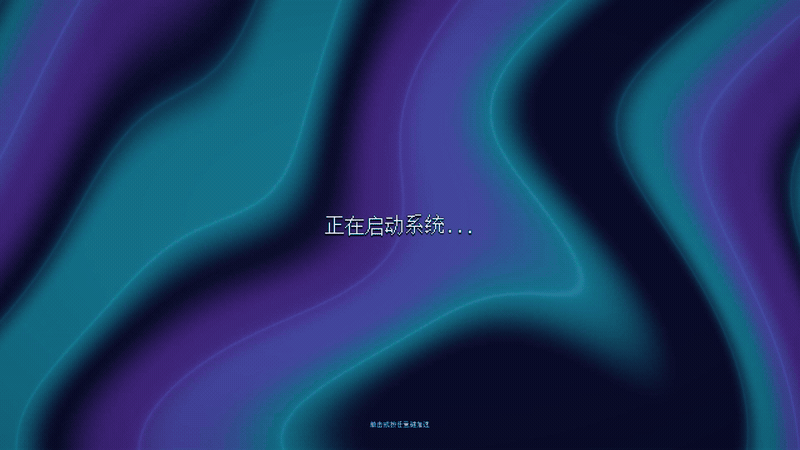

# 全屏波浪与中心溶解启动转场

## 视觉与节奏

入口为 `res://scenes/desktop/boot_screen.tscn`，根节点挂载 `boot_screen.gd`。首帧显示居中的“正在启动系统...”和覆盖全屏的深蓝、青色、紫色液态色带，底部提示“单击或按任意键加速”。文字使用项目像素字体，按视口高度选用 32 或 48 像素。

正常停留 1.6 秒，随后用 1.4 秒从屏幕中心向外溶解。边界使用平滑噪声形成不规则波纹，附带轻微亮边；文字与背景使用同一遮罩一起擦除。结束时完整露出真实桌面，没有黑屏淡出或桌面重新实例化。



[完整清晰视频：1920×1080、30 FPS、3.6 秒](boot_screen_review/boot_transition.mp4)

## 场景交接与输入

`boot_transition.tscn` 是独立 CanvasLayer 场景，由 `boot_transition.gd` 管理。启动入口先将它移到场景树根节点，再通过标准 `change_scene_to_file` 准备桌面；封面不随入口释放。

封面内容放在 CanvasGroup 内：ColorRect 绘制程序化波浪，RichTextLabel 保留原生编辑能力，CanvasGroup 材质从合成结果中统一溶解文字和背景。InputBlocker 独立于溶解内容，在透明区域同样阻止点击穿透。没有新增 Autoload。

桌面初始化并完成真实绘制后才允许打开遮罩；若准备较慢，停留阶段自动延长。转场期间桌面根节点暂停处理，控制器消费输入。鼠标按下或非重复按键触发加速，在最多约 0.6 秒内完成剩余溶解；已经更快时保持当前速度，重复输入不重置进度。准备期间的加速请求会在桌面就绪后生效。

转场结束后恢复桌面原处理模式，释放封面与控制器。提前销毁封面也恢复处理状态，避免桌面永久失去操作能力。

## Inspector 参数

| 位置 | 参数 | 默认值与作用 |
| --- | --- | --- |
| BootScreen 根节点 | `boot_duration` | 3 秒，总播放时间 |
| BootScreen 根节点 | `dissolve_duration` | 1.4 秒，正常溶解时间；停留时间由总时长减去它得到 |
| BootScreen 根节点 | `accelerated_duration` | 0.6 秒，加速后的最长剩余溶解时间 |
| BootTransition → CoverGroup → Cover → Waves → Material | `base_color` / `accent_color` / `secondary_color` | 深蓝底色、青色与紫色配色 |
| 波浪材质 | `animation_speed` / `wave_scale` / `distortion_strength` | 波浪速度、色带尺度、扭曲强度 |
| CoverGroup → Material | `edge_roughness` / `noise_scale` | 溶解边缘起伏强度与尺度 |
| CoverGroup → Material | `edge_width` / `edge_color` | 柔和亮边的宽度与颜色 |
| CoverGroup → Material | `progress` | 编辑器静态预览：0 全覆盖、1 全透明；运行时由控制器推进 |
| Cover → Center → Status | `text` / 主题覆盖 | 主文案、颜色、描边及字体 |

按屏幕宽高比校正波浪和径向距离，使中心开孔保持圆形基准。CanvasGroup 下的封面 Control 显式同步视口尺寸；不要依靠其 Node2D 父节点的全屏锚点计算布局。

## 逐字波浪文字

`CoverGroup/Cover/Center/Status` 使用原生 RichTextLabel，启用 BBCode，当前文本为：

```text
[wave amp=20.0 freq=4.0 connected=0]正在启动系统...[/wave]
```

`amp` 控制起伏幅度，`freq` 控制速度，`connected=0` 让字形独立运动。所有文字从首帧完整显示，不做打字机式逐字出现；动画由 RichTextLabel 自身推进，不逐帧重新解析 BBCode。

文字横纵居中，预留 384×112 的最小区域供波浪、描边及阴影伸展，关闭滚动、自动换行和右键菜单。视口变化时覆盖 `normal_font_size`；字体颜色使用 `default_color`，不沿用 Label 的字号与颜色键。字体与文案仍可在场景编辑器修改。

当前参数的录制帧检查表明，各字符区域在不同时刻有不同方向的纵向位移，且没有上下裁切；三组分辨率的布局及整体溶解检查通过。

## 着色器优化建议

以下是针对当前代码的静态分析建议，尚未应用性能改动，也没有测量各方案的 GPU 收益。应先在目标设备的 Visual Profiler 中区分波浪绘制、CanvasGroup 合成与溶解计算的耗时，再逐项对照。

| 优先级 | 当前开销与建议 | 取舍 |
| --- | --- | --- |
| 高 | `boot_dissolve.gdshader` 在计算两层噪声及指数亮边之后才处理 `progress=0/1`。将端点判断前移：停留阶段只采样封面，完全透明时直接输出透明结果。 | 不改变端点画面；最值得优先实测 |
| 中 | 先计算径向距离，利用噪声的已知幅度范围判断像素是否远离溶解边缘；仅在边界带计算完整噪声与亮边。 | 要覆盖噪声最大偏移与柔化宽度；避免错误裁掉边缘，分支收益依显卡而定 |
| 中 | 波浪当前执行 4 轮包含 sin/cos 的坐标扭曲；可提供 3 轮或 2 轮的画质档位。 | 减少全屏运算，但旋涡细节和流动形态会变化，需要视觉对照 |
| 中 | 高分辨率受像素填充限制时，只将背景波浪放入 0.75 或 0.5 尺寸的 SubViewport，再与全分辨率文字一起合成。 | 背景更柔和；不要降低整个 CanvasGroup 分辨率，以免像素文字和溶解边缘一起变糊；额外纹理采样也有成本 |
| 低 | 可对比预生成的无缝噪声纹理与当前两层解析噪声，或用较便宜的 smoothstep 轮廓替换指数亮边。 | 将算术开销换成采样开销，或改变亮边衰减观感，不保证所有设备都更快 |

画质方面，可使用 `fwidth` 为溶解边缘设定最小屏幕像素宽度，减少不同分辨率下的锯齿和细边闪动。现有 `fit_margin=0`、`clear_margin=0`、关闭 mipmap 及转场后释放封面均已保留；不要为短暂启动页加入持续运行的后处理。

参考：[Godot GPU optimization](https://docs.godotengine.org/en/stable/tutorials/performance/gpu_optimization.html)、[BBCode wave](https://docs.godotengine.org/en/stable/tutorials/ui/bbcode_in_richtextlabel.html#wave)。

## 验收与复现

2026-10-15，Godot 4.7.2，Forward+ / D3D12。

- 启动专项：48 项检查通过，覆盖 800×600、1280×720、1920×1080，包含真实 GPU 帧、居中布局、动态波浪、中心露出、角落保留和结束时逐像素一致。
- 输入与生命周期：检查按键释放与自动重复、鼠标加速、途中加速、重复点击、延迟准备、提前销毁、同一桌面实例、封面释放，以及转场后的开始菜单和快捷方式。
- 现有 GUT：5 组脚本、39 项测试、203 个断言通过。
- 完整桌面交互：138 项检查通过，包括启动交接、菜单、应用导航、导入、学习和剧情；使用已导入的对话资源，不调用外部模型服务。

RichTextLabel 调整后复验启动专项 48 项及现有 GUT 39 项、203 个断言，全部通过；完整桌面 138 项记录沿用既有转场验收。连续视频及截图已按当前富文本场景重新生成。

验证工程保存在 `.temp/boot_review`，使用独立 `application/config/name`，不连接正式玩家数据库或存档。保留 `dialogue_manager` 编辑器导入插件，停用 MCP 插件；先运行隔离工程的导入，再运行验收。

`tests/desktop/verify_boot_transition.gd` 要求配置名为 `KnowledgeAdminBootVerification`，通过 Godot 的 `--script res://tests/desktop/verify_boot_transition.gd` 运行。它输出完整结果及所有分辨率的停留、初期、中期、后期与结束截图。

`tests/desktop/verify_desktop.tscn` 要求配置名为 `KnowledgeAdminDesktopVerification`，已改为等待启动遮罩释放后再操作桌面。

结果：[启动专项报告](boot_screen_review/verification.json)、[GUT 汇总](boot_screen_review/gut_summary.txt)、[桌面验收报告](boot_screen_review/desktop_verification.json)。

画面：[停留](boot_screen_review/boot_1280x720.png)、[溶解初期](boot_screen_review/early_1280x720.png)、[溶解中期](boot_screen_review/middle_1280x720.png)、[溶解后期](boot_screen_review/late_1280x720.png)、[完成](boot_screen_review/complete_1280x720.png)、[1920×1080](boot_screen_review/boot_1920x1080.png)、[800×600](boot_screen_review/boot_800x600.png)。

实现依据：[Godot CanvasGroup](https://docs.godotengine.org/en/stable/classes/class_canvasgroup.html)、[CanvasItem shaders](https://docs.godotengine.org/en/stable/tutorials/shaders/shader_reference/canvas_item_shader.html)。
