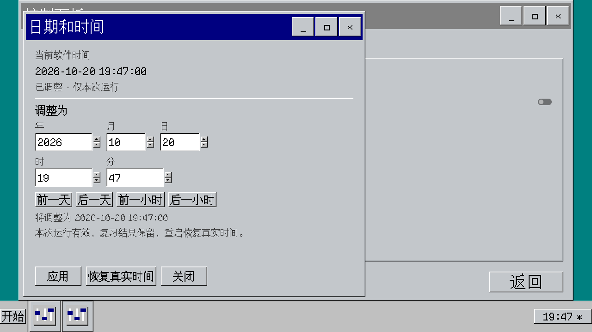
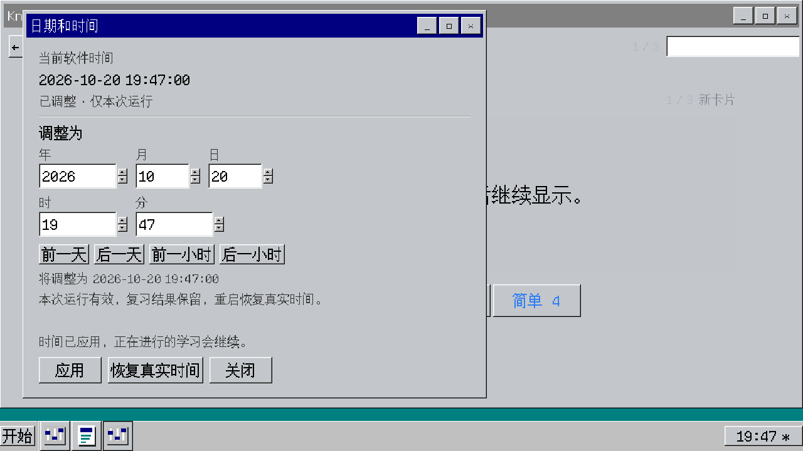

# 日期和时间

## 使用方式

单击右下角时钟，或在控制面板「通用」页选择「调整日期和时间…」，打开共用的单实例窗口。时钟也支持焦点与 Enter 激活；最小化后再次打开会恢复窗口。独立运行设置页面时使用同一内容的嵌入子窗口。

输入年月日时分，或使用前后一天、前后一小时按钮调整草稿。快捷跳转不会立即生效；「应用」才改变软件时间，秒数设为零。「关闭」丢弃未应用草稿。「恢复真实时间」立即清除偏移。非法日期只显示错误，不改变当前时间。

右下角的 `*`、完整日期提示和设置页标明已调整状态。时间继续按真实速度前进，每次启动整个程序恢复真实时间；关闭、重开软件内窗口保持偏移。

## 对闪卡的影响

软件时间影响新卡初始到期日、学习卡秒级到期、复习卡天级到期、评分历史、下一次复习安排、首页统计和牌组选择页的到期数量。日期显示使用系统当前时区；复习日仍按 `int(unix_seconds / 86400)` 切换。

评分照常保存，重启不会撤销记忆状态、评分历史或到期时间。未来时间下的复习记录在恢复真实时间后仍保留；今日统计只查询当前复习日的上下界，因此不会计入未来记录。笔记、牌组等创建时间继续使用真实时间。

调时本身只修改内存偏移，不批量平移数据库中的到期值。旧学习卡若仍保存天索引，会保持已到期状态；下一次正常评分后写入秒级时间。FSRS 使用 1 分钟、10 分钟学习步进及 10 分钟重学习步进；SimpleScheduler 的 Again 使用 10 分钟。数据库表结构保持兼容。

## 学习连续性

调时保留当前卡片、正文、正反面、答题起点、已完成数量及统计，不重复发出显示卡片或评分事件。除当前卡片外，剩余队列按新时间重新查询，按 ID 去重并保持学习卡、新卡、复习卡的顺序。当前卡即使因回退变为未到期，也允许完成本次作答；算法的经过时间最低为零。

本轮已接纳的新卡和复习卡 ID 累计占用各自额度，调时不重置额度，同一卡再次到期不重复占名额；学习卡沿用不设数量上限的规则。进度总数为已完成数量加当前剩余数量，初始数量另行保留。已完成的会话不会因调时自动开始。

查询失败时保持当前卡面与旧队列，暂停评分和跳卡，显示「重试刷新」。重试或再次调时查询成功后恢复。翻面和退出学习仍可使用。单题及整轮耗时使用 `Time.get_ticks_msec()`，快进日期不计入学习时长。

## 接口与维护入口

| 接口 | 用途 |
| --- | --- |
| `AppClock.now_unix()` | 获取系统秒数加内存偏移 |
| `AppClock.local_datetime()` / `display_datetime()` | 按系统当前时区显示日期时间 |
| `AppClock.datetime_to_unix(date)` | 验证日期并转换，不改变时钟 |
| `AppClock.set_datetime(date)` | 应用有效日期，返回 `success`、`data` 或 `error` |
| `AppClock.reset_to_system()` | 清除偏移 |
| `AppClock.time_changed` | 手动应用或恢复后的刷新通知 |
| `AppClock.day_changed(day_index)` | 自然跨复习日通知，手动调时不重复发送 |
| `WindowContext.open_time_settings(content)` | 桌面或独立页面共用的窗口入口 |
| `StudyManager.refresh_for_time_change()` | 保留当前卡片并重建剩余队列 |
| `StudyManager.queue_refresh_status_changed(message)` | 非空时暂停评分，空字符串表示可继续 |
| `Scheduler.format_interval(state, now_timestamp)` | 从同一次计算的状态生成保存结果文案，避免再次抽取随机间隔 |

可编辑场景为 `res://content/scenes/desktop/time_settings.tscn`，行为脚本为 `res://src/desktop/time_settings.gd`，时间服务为 `res://src/app_clock.gd`。卡片数据层通过业务层显式传入时间，不读取全局时钟；一次评分只采样一次时间。

## 验证记录

Godot 4.7.2 下，新增 20 项 GUT 测试、211 条断言全部通过。完整回归为 147 项中 140 项通过，7 项失败与改动前 127 项中原有的同一组「我的电脑」控件引用失败一致，没有新增失败。

Forward+ / D3D12 实际渲染通过 119 项检查，覆盖 1280×720、1920×1080 与 80%、100%、150% 字号、480×400 最小窗体、鼠标和键盘入口、模态锁、独立设置窗口和真实学习场景。另用两个独立进程完成 12 项检查，确认时钟重置、未来复习记录保留及今日统计。

布局、资源引用及所有函数注释检查通过。完整回归日志仍有原有控件引用失败；测试环境另有已有的证书读取、日志及着色器缓存写入诊断，未作为本功能通过的依据。

原始检查报告和截图见 [验证证据](desktop_review/time_settings/verification.json)、[重启写入](desktop_review/time_settings/restart_write.json)、[重启读取](desktop_review/time_settings/restart_read.json) 及 [回归对照](desktop_review/time_settings/test_summary.json)。

